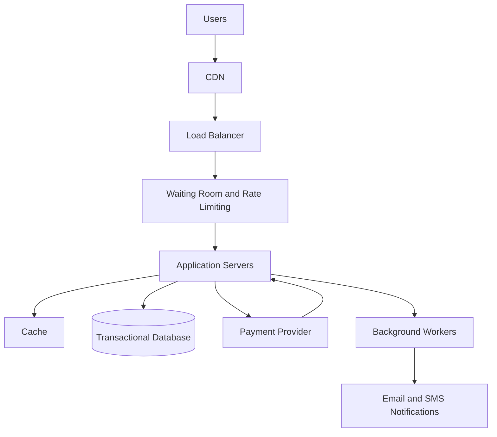

# TicketHub: System Design Document

## 1. Requirements

### Functional Requirements
- Users can browse events and view event details.
- Users can view available seats and ticket prices.
- Users can temporarily hold a seat while completing payment.
- Users can pay for tickets and receive booking confirmation.
- Users can view their purchased tickets.
- The system prevents two users from successfully booking the same seat.

### Non-Functional Requirements
- **Scalability:** Handle sudden increases in traffic during popular ticket sales.
- **Reliability:** Remain available and recover from failures.
- **Performance:** Load event pages quickly and respond to booking requests promptly.
- **Consistency:** Prevent double-booking and maintain accurate ticket availability.
- **Security:** Protect user information and payment transactions.

## 2. Traffic Estimates

### Normal Day
- Registered users: 2,000,000.
- Daily visitors: 50,000.
- Page views per visitor: 10.
- Total daily page views: 50,000 × 10 = 500,000.
- Average page views per second: 500,000 ÷ 86,400 ≈ 5.8.
- Tickets sold per day: 5,000.

The average of 5.8 page views per second is an estimate, not the total number of requests generated by the system. Each page may trigger additional requests for images, APIs and other resources.

### Popular Concert Sale
- Potential buyers: 200,000.
- Tickets available: 20,000.
- Sale duration: 10 minutes.
- Average arrival rate: 200,000 ÷ 600 ≈ 333 people per second.
- Potential buyers per available ticket: 200,000 ÷ 20,000 = 10.

The system must handle a large traffic spike and competition for limited seats. Actual peak traffic may be higher than the average.

## 3. API Design

| Method | Endpoint | Purpose |
|---|---|---|
| GET | /events | List available events |
| GET | /events/:eventId | View event details |
| GET | /events/:eventId/seats | View seat availability |
| POST | /seats/:seatId/hold | Temporarily hold a seat |
| POST | /orders | Create a booking order |
| POST | /orders/:orderId/pay | Initiate payment |
| GET | /me/tickets | View purchased tickets |

The API should authenticate users where necessary, validate requests and return appropriate errors. For example, a seat that is no longer available should return a conflict response rather than create another booking.

## 4. Database Design

### Users
- user_id (primary key)
- name
- email
- created_at

### Events
- event_id (primary key)
- title
- venue
- event_date

### Seats
- seat_id (primary key)
- event_id (foreign key)
- seat_number
- status (available, held or sold)

Each seat belongs to an event. A unique constraint on event_id and seat_number prevents duplicate seat records for the same event.

### Orders
- order_id (primary key)
- user_id (foreign key)
- status (pending, paid, failed or expired)
- total_amount
- created_at

### Order_Items
- order_item_id (primary key)
- order_id (foreign key)
- seat_id (foreign key)
- price

### Seat_Holds
- hold_id (primary key)
- seat_id (foreign key)
- user_id (foreign key)
- expires_at
- status

Relationships:
- One user can create many orders.
- One event has many seats.
- One order can contain multiple order items.
- Each order item refers to a seat.
- A seat hold records which user temporarily holds a seat and when the hold expires.

### Preventing Double-Booking

The database must be the authoritative source for seat availability. When two buyers attempt to reserve the same seat, the system must perform an atomic update or use a transaction with appropriate locking or constraints.

For example:

```sql
UPDATE seats
SET status = 'held'
WHERE seat_id = 12
  AND status = 'available';
```

The application checks the number of rows updated. If one row was updated, the reservation succeeded. If zero rows were updated, the seat was no longer available.

The system should also record the hold expiry time, release expired holds safely, and mark a seat as sold only after successful payment confirmation. These operations must be coordinated transactionally so a seat cannot be held or sold twice.

## 5. System Architecture



### Component Responsibilities

- **CDN:** Serves static files such as images, stylesheets and scripts closer to users.
- **Load balancer:** Distributes incoming requests across application servers.
- **Waiting room and rate limiting:** Controls traffic entering the booking system during high-demand sales.
- **Application servers:** Process event browsing, reservations, orders and payments.
- **Cache:** Speeds up access to suitable frequently requested data, such as event details. It must not be the final authority for seat reservations.
- **Transactional database:** Stores users, events, seats and orders and protects booking consistency.
- **Payment provider:** Processes payments and reports payment outcomes.
- **Background workers:** Handle tasks such as notifications and other work that does not need to block the user request.

The application servers can scale horizontally by adding more instances. The database requires separate monitoring and capacity planning because it can remain a bottleneck even when application servers scale.

## 6. Design Trade-Offs

### Trade-Off 1: Waiting Room vs. Immediate Access

A waiting room reduces sudden pressure on the system and helps control traffic during a popular sale. However, users may have to wait before accessing tickets. Immediate access feels faster under normal conditions but can overwhelm the system during a traffic spike.

**Decision:** Use a waiting room for high-demand sales and allow normal access when traffic is manageable.

### Trade-Off 2: Consistency vs. Availability

The system must ensure that only one buyer can successfully reserve a seat. Strict booking consistency may require database transactions or locking, which can increase latency and reduce throughput under heavy contention. Allowing reservations without reliable checks could cause double-booking.

**Decision:** Prioritise correct seat allocation over accepting every booking request immediately.

### Trade-Off 3: Caching vs. Fresh Data

Caching event details reduces database load and improves response times. However, cached seat availability may become outdated when another buyer reserves a seat.

**Decision:** Cache suitable read-heavy information, but verify seat availability against the database when processing reservations.

## Conclusion

TicketHub needs an architecture that can handle normal traffic efficiently and manage sudden spikes during popular ticket sales. A waiting room, scalable application servers, carefully selected caching and a transactional database help the system remain responsive while protecting ticket availability and preventing double-booking.
